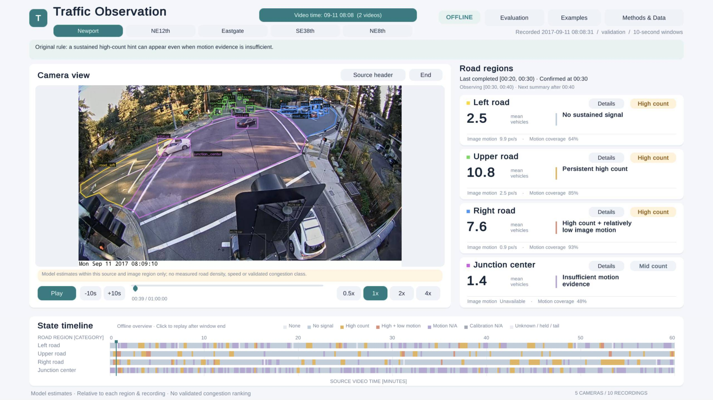

# Traffic Observations: thesis code and supporting records

**Package version: thesis-source-package-v1.**

Repository: [zokiyyy/traffic-observations-thesis](https://github.com/zokiyyy/traffic-observations-thesis). This package accompanies the thesis on regional vehicle counts, image-motion indicators, persistent rule-based hints and an offline Unity replay prototype. It does not establish traffic-state accuracy or user understanding.

## Interface preview



Thesis screenshot of the initial Newport recording with the original output rules. The interface presents saved regional counts, image motion and persistent hints alongside video replay; it does not establish congestion accuracy. Camera footage: [City of Bellevue Traffic Video Dataset](https://github.com/City-of-Bellevue/TrafficVideoDataset). This static preview is separate from the external runtime media; see [image provenance and availability](MEDIA_NOTES.md).

## Start here

- Chinese review guide: [整理说明](整理说明.md).
- [Verified capabilities and limitations](VERIFICATION.md).
- [Data access and missing inputs](DATA_ACCESS.md).
- [Dependencies](DEPENDENCIES.md).
- [Configure local paths](CONFIGURATION.md), [Unity setup](UNITY_SETUP.md), and [path change record](PATH_CHANGES.md).
- [Material/version index](FILE_INDEX.md).
- [Acknowledgements and provenance](ACKNOWLEDGEMENTS.md).
- Historical files are retained as evidence. Some internal README files describe earlier project stages; this root README describes the release candidate.

The original project-relative directory layout is preserved. Original copied code, configurations and result files are byte-identical to their sources. `release_manifest.json` lists required repository evidence; `MODEL_MANIFEST.json` separately lists optional checkpoint attachments. An inventory entry is not a claim that its script can run without external data. This package contains selected dependencies and records, not every historic output.

## Five parts of the thesis

| Part | Location relative to this repository | Purpose |
|---|---|---|
| Detection and evaluation | `formal_research/traffic_yolo_system/src`, `configs`, `tests`, `outputs/training`, `outputs/evaluation`, `outputs/validation_tuning` | Training, threshold comparison and Main Test records; associated scripts and configurations |
| Continuous video pipeline | `formal_research/traffic_yolo_system/src/full_video` and retained output-run `code/`, `config/`, `validation/` directories | Decoding/PTS, detection, filtering, tracking, region assignment and 10-second aggregation |
| States and rules | `.../outputs/five_intersection_states_2026-09-28_v1` and `.../outputs/supplementary_states_2026-09-28_v1` | Initial output and supplementary stricter output; they are not interchangeable |
| Evaluation analyses | `.../outputs/persistence_sensitivity_2026-09-28`, `.../outputs/paired_case_comparison_2026-09-28_v1`, and the audit path below | Duration sensitivity, paired recordings and regional-count diagnostics |
| Replay prototype | `formal_research/traffic_unity_demo` and `formal_research/traffic_unity_web` | Separate desktop and web Unity source projects, imports/build scripts and retained historical verification summaries |

The full audit path is `formal_research/12_thesis_draft/revision_2026-10-23/comprehensive_revision_work/roi_count_audit/`. This long path is intentional: moving only `main_test/` breaks its parent-script dependency. The parent directory describes Validation; `main_test/` describes the 184-image Main Test. No thesis draft documents are included.

## Run the verified, video-free checks

Use Python 3.10 or newer. This helper uses the standard library and does not run YOLO, read images, contact a server or start Unity:

```sh
python3 tools/verify_release.py --output release_checks/my_check_001
```

Choose a new output folder each time; the helper refuses to overwrite an existing one. Original tests that write reports run in a temporary copy. Retained evidence is checked for unchanged hashes before and after the run.

This command:
1. Checks copied-file hashes and Python syntax.
2. Recomputes Main Test count errors from the retained 796-row image-region count table, including camera and empty/nonempty breakdowns.
3. Runs the 19 frozen-rule and 11 stricter-display boundary checks.
4. Reruns the original 20/30/60-second persistence analysis and compares numeric results.
5. Calls the original supplementary production functions on the retained count/motion windows, comparing thresholds, labels, flags and reasons against 6,342 saved region-windows.

Model files are not needed for this command. If present, their hashes are checked; if absent, the report marks them as optional and missing. To require both downloaded model attachments as well, add `--require-models`.

It does **not** rerun the image/box provenance audit, raw video pipeline, model evaluation, original full provenance verifier, or Unity interaction checks. `tools/verify_release.py` is a packaging-time helper, not a script used in the original experiments.

## Prototype

The recorded demonstration URL is:
https://play.unity.com/en/games/9c5f58ce-768e-4850-9f1e-20947121b19f/traffic-observations-10

The URL was retained from the thesis; availability and exact alignment with the packaged source were not revalidated during packaging. Both Unity projects record Editor **6000.6.3f1**. Assets, retained `.meta` files, Packages and ProjectSettings are included. Videos and original evaluation-case images are not. See `UNITY_SETUP.md` and `DATA_ACCESS.md` before attempting a build; the package is not a self-contained runnable video demo. Empty case-image folders are retained, and the affected build entry points are documented.

## Model checkpoints

The **final trained YOLO11s detector** is available from [Release thesis-v1.0](https://github.com/zokiyyy/traffic-observations-thesis/releases/tag/thesis-v1.0) as `yolo11s_thesis_best.pt`, together with its checksum file and model card. See [MODEL_CARD.md](MODEL_CARD.md) for the exact SHA-256, class mapping, verification command and destination path. Its bytes match the original selected checkpoint and the frozen Main Test model hash.

The YOLO11n comparison checkpoint remains unpublished. Model binaries are excluded from normal Git commits; download the YOLO11s attachment separately. The default video-free checks do not require models. If installed at its documented path, YOLO11s is hash-checked automatically. `--require-models` additionally requires the unpublished YOLO11n comparison file, so it is not needed for this release's basic verification.

## Scope of reproducibility

- **Source inspection:** included source and configuration snapshots can be inspected.
- **Partial result recomputation:** verified through the command above using saved observations/tables.
- **Full rerun:** requires external videos, exact annotated images/labels and manifests, model/configuration setup, compatible dependencies and, for some original audit entry points, retained large logs and original path mappings. Full rerun and Unity builds have not been verified from this package.

The baseline source data are identified at https://github.com/City-of-Bellevue/TrafficVideoDataset . Downloading source videos does not recreate the author's exact image annotations automatically. This package does not grant redistribution rights to external datasets, packages or models.

## Local configuration and verification status

To prepare machine-specific detector configurations without changing research records, follow `CONFIGURATION.md`. Configuration generation is separate from inference and reports missing inputs.

`VERIFICATION.md` reports the latest check of the actual Git-selected file set. `release_checks/run_001` is the historical full-folder check; `release_checks/run_002` is the distribution check; `release_checks/run_003` repeats verification after the README preview addition. Required repository files and optional checkpoints are intentionally separated. `SHA256SUMS.txt` covers the repository payload (excluding the checksum file itself); checkpoint hashes are in `MODEL_MANIFEST.json`.

Historical machine-path strings remain in archival evidence and are listed in `LOCAL_PATH_INVENTORY.json`; they are not runnable defaults or download instructions. Authorship/third-party notices are in `ACKNOWLEDGEMENTS.md`. The source repository is public. The final YOLO11s model is available as a Release attachment; the YOLO11n comparison model remains unpublished. This repository does not include raw videos or the full annotated image dataset.
